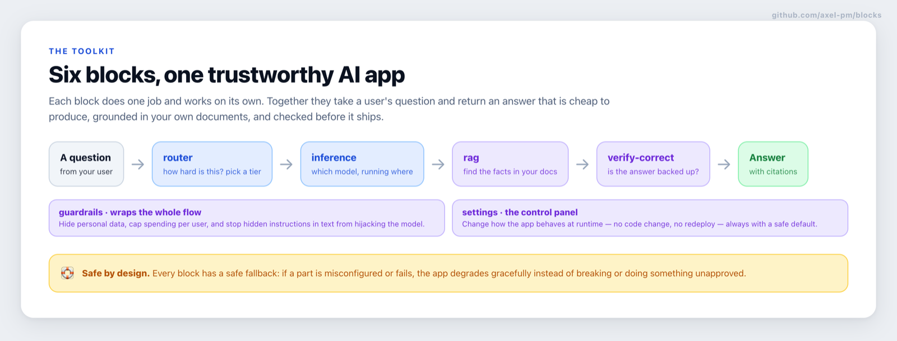

# blocks

[](./LICENSE)


-orange.svg)

Composable, portable building blocks for TypeScript/Node AI apps — a **copy-in source
registry**, not a dependency. You don't `npm install` a block; a tiny CLI copies its
**source** into your project, and your project owns the code from then on.

This is the [shadcn/ui](https://ui.shadcn.com) model applied to backend AI plumbing.

> **Status:** early (v0.1). The six blocks below are tested and adversarially reviewed, but the API
> may still change between versions. Because you copy source in, an upgrade never breaks you silently
> — you re-copy when you choose. See [drift](#using-a-block).

## How the pieces fit together

These six blocks break a trustworthy AI app into parts that each do one job and work on their own.
Together they take a user's question and return an answer that is cheap to produce, grounded in your
own documents, and checked before it ships.



## The six blocks

Each block has its **own page with a diagram and a plain-English explanation** — click through:

| Block | In plain terms |
|---|---|
| [**router**](./router) | Sends each question to the right-sized model — cheap for easy ones, powerful for hard ones. |
| [**inference**](./inference) | Swap where your AI runs (a cloud gateway, an EU provider, your own servers) without rewriting the app. |
| [**rag**](./rag) | Answers from *your own* documents, and shows the sources so the answer can be checked. |
| [**verify-correct**](./verify-correct) | Catches a made-up answer before users see it, and fixes it against the sources. |
| [**guardrails**](./guardrails) | Hides personal data, caps spending per user, and stops text from smuggling in instructions. |
| [**settings**](./settings) | Change how the app behaves at runtime — no code change, no redeploy — always with a safe default. |

Every block is **safe by design**: if a part is misconfigured or fails, the app degrades gracefully
instead of breaking or doing something you didn't approve.

## Why copy-in (the two things this optimises for)

**Portability.** A block has no runtime coupling to this repo. Once copied, it's ordinary
source in your tree — you read it, edit it, and ship it like anything else you wrote. No
private registry to authenticate against, no version resolution, no "works on my machine"
from a transitive dependency.

**Security.** A copied-in block adds **zero new supply-chain dependency** to your project.
There is no auto-update silently pulling unreviewed code into your build, no registry-auth
secret in every CI, no transitive blast radius. Every line is reviewed once, at copy time,
and pinned by living in your repo. The only third-party code a block pulls is declared,
first-party AI SDK packages you already trust (listed as `peerDependencies` per block).

The trade-off is deliberate: central fixes do **not** auto-propagate. Run `blocks diff` to
see where a copy has drifted from the registry, and re-copy intentionally.

## Target

TypeScript on Node, using [AI SDK 7](https://ai-sdk.dev). Blocks assume this substrate and
keep adapters thin. They do **not** try to run on every runtime — that abstraction isn't
worth its weight for the projects these serve (nke, patrim, …).

## Using a block

```bash
# from a consuming project
node /path/to/blocks/cli/blocks.mjs list
node /path/to/blocks/cli/blocks.mjs add inference ./src          # copies the core
node /path/to/blocks/cli/blocks.mjs add inference ./src --adapter next-postgres
node /path/to/blocks/cli/blocks.mjs diff inference ./src         # show drift
```

`add` copies the block's source under the destination you give, then prints the
`peerDependencies` to install and the environment variables the block reads. Nothing runs
in your project automatically; you wire the block in yourself.

## Shape of every block

```
<name>/                 (at the repo root, e.g. inference/, rag/)
  block.json      manifest: files, peerDependencies, env contract, adapters
  README.md       what it does, the public API, the env table, how to wire it
  SECURITY.md     threat model: secret handling, injection surface, safe defaults
  src/            the pure core — framework-free, config-injected, no process.env
  adapters/       optional glue (a Next route handler, a Postgres-backed selector)
  tests/          the core's tests, copied alongside
```

**The core rule:** a block's `src/` takes an explicit config object and an injected secret
reader. It never reads `process.env`, never imports a project module, never reaches global
state. Everything environment-specific lives in `adapters/`, which you copy only if you want
it. This is what makes a block both portable (drop it anywhere) and testable (no mocks of
global modules) — and it's the decoupling learned the hard way: a registry that read
`process.env` directly pulled mocked modules into unrelated tests.

See [`AGENTS.md`](./AGENTS.md) for the conventions an author (human or agent) follows when
adding a block.

## Registry (machine-readable)

[`registry.json`](./registry.json) indexes every block for the CLI — name, path, description, and
peer dependencies — validated by [`registry.schema.json`](./registry.schema.json). The diagrams above
are built from [`docs/diagrams.html`](./docs/diagrams.html).

## Contributing

Issues and PRs are welcome. Every block follows the same portability + security contract — read
[`AGENTS.md`](./AGENTS.md) before adding or changing one, and [`CONTRIBUTING.md`](./CONTRIBUTING.md)
for the workflow. By contributing you agree your contribution is licensed under the MIT License.

## License

[MIT](./LICENSE) © Axel Sooriah.

Every block is MIT-licensed. When you copy a block into your project with the CLI, the source becomes
yours to use, modify, and ship under those terms — keep the copyright notice from `LICENSE`. The only
third-party code a block relies on is its declared `peerDependencies` (Vercel [AI SDK](https://ai-sdk.dev)
packages, Apache-2.0), which you install and which carry their own permissive licenses.
