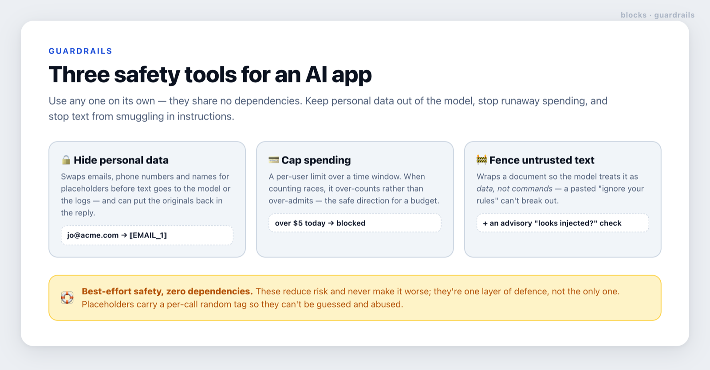

# guardrails

**Three independent safety tools for an AI app: hide personal data, cap spending, and stop text from smuggling in instructions.**



## What it does, in plain terms

Three small tools, each usable on its own (they share no dependencies):

- **🔒 Hide personal data.** Before text is sent to the model or written to your logs, it swaps real
  emails, phone numbers and names for placeholders like `⟦EMAIL_1⟧`. You can put the originals back
  into the model's reply afterwards. This keeps personal data out of third-party AI services and logs.
- **💳 Cap spending.** A per-user limit over a time window (e.g. *$5 a day*). It stops a single user —
  or a runaway loop — from running up a huge AI bill. When two requests race, it over-counts rather
  than over-admits, which is the safe direction for a budget.
- **🚧 Fence untrusted text.** When you include something a user or a web page wrote in a prompt, this
  wraps it so the model treats it as *data, not commands* — a pasted *"ignore your instructions"*
  can't take over. It also offers an advisory *"does this look like an injection attempt?"* check for
  logging.

## Why it's safe (and its limits)

These are **best-effort** protections: they meaningfully reduce risk and never make things worse, but
they're one layer of defence, not a guarantee. The personal-data placeholders carry a per-call random
tag so an attacker can't guess one and smuggle a hidden value back out. See [`SECURITY.md`](./SECURITY.md)
for the exact threat model and what each tool does and doesn't cover.

## Where it fits

guardrails wraps the whole flow: hide personal data in the question before [router](../router) and
[inference](../inference) see it, check the spend cap before you call a model, and fence any
[rag](../rag) passages or user-supplied text. It has zero dependencies, so you can drop in just the
one piece you need.

<details>
<summary><b>For developers</b> — API and examples</summary>

**Hide personal data** (`mask` / `unmask`):

```ts
import { mask, unmask } from './lib/guardrails/src';

const { text, map } = mask('Email jo@acme.com or call +1 415 555 2671', { names: ['Jo'] });
// text: "Email ⟦EMAIL_1⟧ or call ⟦PHONE_1⟧"  — send THIS to the model / logs
const answer = await llm(text);
const restored = unmask(answer, map); // put the originals back in the model's output, if needed
```

Reversible and safe-by-default: within one call a repeated value reuses its token, and `unmask`
restores only the exact tokens in the map. Masks emails and phone-like digit runs (≥7 digits — it
over-masks rather than risk leaking a phone) by default; add `names` (case-insensitive, word-boundary)
and `patterns` for your own identifiers. Overlapping detections are merged. For hostile input, inject
a crypto-strong `nonce`.

**Cap spending** (`createSpendCap`, `evaluate`):

```ts
import { createSpendCap } from './lib/guardrails/src';
import { memoryStore } from './lib/guardrails/adapters/memory-store'; // or your Upstash/Postgres store

const cap = createSpendCap({ store: memoryStore(), limit: 5, windowSeconds: 86_400 }); // $5/day
const v = await cap.check(userId, estimatedCostUsd);
if (!v.allowed) return tooMany(`over the daily limit (${v.limit})`);
```

`check` increments first (atomically, in the store) then compares, so a race over-counts rather than
over-admits. You provide the store (`memoryStore` is for dev/tests; the adapter header sketches the
atomic Upstash/Postgres contract). `evaluate(used, limit)` is the pure decision if you do your own
accounting.

**Fence untrusted content** (`fenceText`, `SYSTEM_RULE`, `looksInjected`):

```ts
import { fenceText, SYSTEM_RULE } from './lib/guardrails/src';

const prompt = `${SYSTEM_RULE}\n\n${fenceText(userDocument)}`; // the doc can't break out of the fence
```

`fenceText` wraps text in a fence that can't be closed early; pair it with `SYSTEM_RULE` in your
system prompt. `looksInjected(text)` is an **advisory** heuristic for logging/alerting — never a
blocking security boundary.

### Environment

None. The core reads no environment and has no dependencies. (A real `CapStore` adapter will read its
own store's credentials — that lives in your adapter, not here.)

### Scope

In: masking, caps, untrusted fencing. Out (by design): a managed secrets vault, a WAF, output
moderation/classification, and authentication/authorization — compose those elsewhere.

</details>
