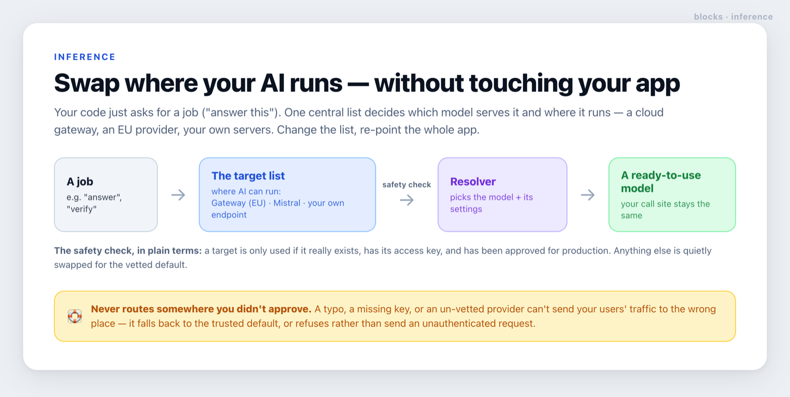

# inference

**Swap where your AI runs — a cloud gateway, an EU provider, your own servers — without rewriting your app.**



## What it does, in plain terms

Most apps hard-code *which* AI model to call and *where* it runs, scattered across the codebase.
Changing provider then means editing dozens of places. This block puts that decision in **one list**.

Your code just asks for a *job* — "answer this", "verify that" — and this block hands back a
ready-to-use model. The list of **targets** (where AI can run) lives in one place: a cloud gateway,
an EU provider like Mistral, your own self-hosted endpoint. Change the list, and the whole app
re-points — no call sites to touch.

This matters for **data residency and sovereignty**: you can move all inference to an EU-pinned or
self-hosted target in one change, when a customer or regulator requires it.

> The block records where each target runs as a label you set (e.g. *"EU-pinned, zero retention"*).
> It doesn't *enforce* residency itself — that comes from the provider endpoint and the options you
> inject. Keep the label honest about what those actually do. See [`SECURITY.md`](./SECURITY.md).

## Why it's safe

A typo, a missing access key, or a provider you haven't approved for production can **never** send
your users' traffic to the wrong place. Before any target is used, it's checked: does it really
exist, is its key present, and has it been approved for production? Anything that fails is quietly
swapped for your vetted default — and if a target is somehow reached without its key, the block
refuses rather than send an unauthenticated request.

## Where it fits

Pair it with [router](../router), which decides *which tier* of model should answer; this block turns
that tier into the actual model, running wherever you've chosen. It's independent of the other blocks.

<details>
<summary><b>For developers</b> — API, example, environment, and migration note</summary>

Install the peer dependencies (drop the providers you don't use):

```bash
npm i ai@^7 @ai-sdk/mistral@^4 @ai-sdk/openai-compatible@^3
```

```ts
// 1. Describe your roles and targets.
type Role = 'router' | 'answer' | 'verify';

const registry = defineRegistry<Role>([
  { id: 'gateway-eu', label: 'Claude (EU)', residency: 'AI Gateway, EU-pinned, zero retention',
    apiKeyEnv: '', mode: 'gateway', enabled: true,
    models: { router: { model: 'anthropic/claude-haiku-5.5' },
              answer: { model: 'anthropic/claude-sonnet-5.5', effort: 'medium' },
              verify: { model: 'anthropic/claude-haiku-5.5' } } },
  { id: 'scaleway', label: 'Scaleway', residency: 'EU open weights',
    apiKeyEnv: 'SCW_SECRET_KEY', baseURL: 'https://api.scaleway.ai/v1',
    mode: 'openai-compatible', enabled: false,   // behind an eval gate
    models: { router: { model: 'mistral-small' }, answer: { model: 'gpt-oss-120b' },
              verify: { model: 'mistral-small' } } },
], 'gateway-eu');

// 2. Build one resolver with YOUR shared gateway options + a secret reader injected.
const { resolve, modelIdOf, effortOf } = createResolver<Role>({
  gatewayOptions,                         // the same object you pass today on a gateway call
  secrets: (name) => process.env[name],   // the one place env is read — your choice, not the core's
});

// 3. At a call site — m.model is typed as ai's LanguageModel, so no cast is needed:
const m = resolve(target, 'answer', { caching: true, thinking: true });
const res = streamText({ model: m.model, providerOptions: m.providerOptions, /* … */ });
audit.model = m.id;                       // raw gateway string, or provider-prefixed off-gateway
```

- `defineRegistry(targets, defaultId)` — validates the default exists and is an enabled gateway
  target; rejects duplicate ids.
- `pickEffectiveTarget(chosenId, registry, { isProd, hasKey })` — the fail-closed chooser: a chosen
  target is honoured only if it exists as an own key (a prototype name like `constructor` never
  matches), is configured (gateway, or off-gateway with its key), and — in production — is `enabled`.
  Otherwise it returns the vetted default.
- `isConfigured(target, hasKey)` — gateway always true; off-gateway needs its key present.
- `createResolver({ gatewayOptions, secrets })` → `{ resolve, modelIdOf, effortOf }`. For a gateway
  target, `resolve` returns the bare model string and your gateway options **by reference** — byte-
  identical to a hand-written call. If handed an off-gateway target whose key resolves empty, it
  **throws** rather than send an unauthenticated request.
- Optional `next-postgres` adapter: `createTargetSelector({ registry, readSetting, writeSetting })`
  gives `effectiveTarget()` (env override → cached DB setting → fail-closed downgrade) and a
  `saveTarget(id)` that refuses to store a choice the core wouldn't honour.

### Environment

| Variable | Required | Default | Purpose |
|---|---|---|---|
| `INFERENCE_TARGET` | no | registry default | **adapter only** — overrides the stored target id |
| `<apiKeyEnv>` per target | only to use that target | unset | the off-gateway key you name on each target; read via your injected `secrets` reader |

The **core reads no environment at all.** Keys and the active-target override reach it only through
the values you pass — that's what makes it portable and unit-testable without global mocks.

### Migrating an existing app

Because the gateway path is byte-identical, lock the refactor with a test asserting the same model
string and the same options object reference, proving the change is a no-op for the path you already
ship.

</details>
