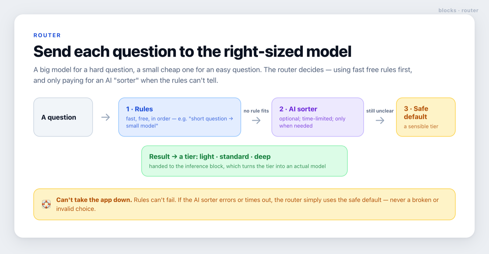

# router

**Send each question to the right-sized model — a cheap one for easy questions, a powerful one for hard ones.**



## What it does, in plain terms

Large AI models are smart but expensive; small ones are cheap but limited. The router looks at each
incoming question and decides which "tier" of model should answer it — so you don't pay for a big
model to answer *"what are your opening hours?"*.

It decides in three steps, stopping at the first that gives an answer:

1. **Rules** — fast, free checks you write, tried in order. For example: *a very short question is
   probably easy → use the light tier*, or *a question containing "compare" or "why" needs
   reasoning → use the deep tier*.
2. **An AI sorter** *(optional)* — only runs when no rule matched. A small, cheap model reads the
   question and picks a tier. It's time-limited, so it can never hang.
3. **A safe default** — if no rule matches and the sorter is unsure or switched off, the router falls
   back to a sensible default tier.

The result is a **tier** (e.g. `light` / `standard` / `deep`). The [inference](../inference) block
turns that tier into an actual model. The router only *decides*; it doesn't call any model itself
(except the optional sorter).

## Why it's safe

The router can never take your app down. Rules are simple and can't fail. If the AI sorter errors,
times out, or returns something that isn't a real tier, the router ignores it and uses the safe
default — it never routes to an invalid or unapproved choice. See [`SECURITY.md`](./SECURITY.md).

## Where it fits

Put the router at the front of your answer flow. Hand its chosen tier to [inference](../inference) to
pick the model, then [rag](../rag) to gather sources and [verify-correct](../verify-correct) to check
the answer. Keep the sorter model small — if sorting costs as much as just answering, route by rules
only and drop the sorter.

<details>
<summary><b>For developers</b> — API, example, and notes</summary>

```ts
import { createRouter, byMaxLength, byKeywords, byContext } from './lib/router/src';
import { aiClassifier } from './lib/router/adapters/ai-classifier'; // optional

type Tier = 'light' | 'standard' | 'deep';

const router = createRouter<Tier, { vip?: boolean }>({
  tiers: ['light', 'standard', 'deep'],
  default: 'standard',
  rules: [
    // Order matters — first match wins. Put specific signals before broad ones.
    byContext('deep', (c) => !!c.vip, 'vip'),
    byKeywords('deep', ['compare', 'why', 'analyze']), // reasoning words → deep (before length)
    byMaxLength('light', 20),                           // otherwise, short → cheap
  ],
  classifier: aiClassifier<Tier>({                      // only runs when no rule matches
    model: 'anthropic/claude-haiku-5.5',
    tiers: ['light', 'standard', 'deep'],
    describe: { light: 'a trivial lookup', standard: 'a normal question', deep: 'multi-step reasoning' },
  }),
});

const { tier, via, reason } = await router.route(query, { vip: user.vip });
const model = inferenceModel(tier); // hand the tier to the inference block
```

- `createRouter<Tier, Ctx>({ tiers, default, rules?, classifier? })` → `{ route(query, ctx) }`.
  Validates that `default` and every rule tier are in `tiers`.
- `route` returns `{ tier, via: 'rule' | 'classifier' | 'default', reason }` — `via` / `reason` are
  handy for logging how each query was routed.
- Rule builders: `byMaxLength`, `byMinLength`, `byKeywords` (whole-word, case-insensitive),
  `byContext` (a predicate over your context). A rule is just `{ tier, when(query, ctx), reason? }` —
  write your own.
- `aiClassifier({ model, tiers, describe, instructions?, providerOptions? })` (adapter) builds the
  sorter from an AI SDK model; it returns `null` for an unrecognised reply so the router falls through
  to the default. It's bounded by `classifierTimeoutMs` (default 3000).

</details>
