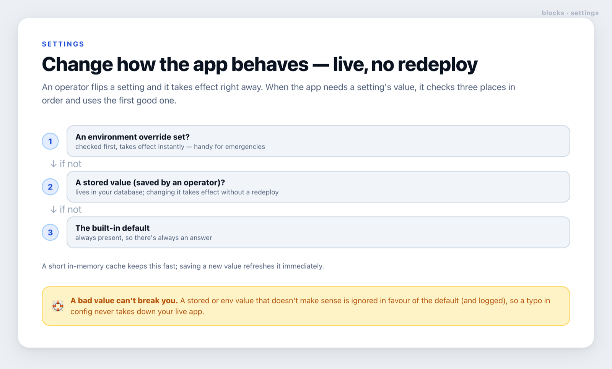

# settings

**Change how your app behaves at runtime — an operator flips a setting and it takes effect immediately, no code change, no redeploy.**



## What it does, in plain terms

Some choices shouldn't need a developer and a deployment to change — which AI provider is active, a
feature on/off, a limit. This block lets a trusted operator change such a setting from your admin
panel and have it take effect right away.

When the app needs a setting's value, it checks three places **in order** and uses the first good one:

1. **An environment override** — checked first and takes effect instantly. Handy for emergencies ("pin
   everyone to the safe provider *now*").
2. **A stored value** — saved by an operator, kept in your database. Changing it takes effect without
   a redeploy.
3. **The built-in default** — always present, so there's always a sensible answer.

A short in-memory cache keeps reads fast; saving a new value refreshes it immediately.

## Why it's safe

A bad value can't break your live app. If a stored or environment value doesn't make sense (won't
parse, or fails your validation), it's **ignored in favour of the default** and logged — a typo in
config never takes the app down. And a value that fails validation is refused at save time, so the
database never holds something the app would reject. See [`SECURITY.md`](./SECURITY.md).

> This block does **not** handle authentication. Only let a super admin (or equivalent) change a
> setting — gate it behind your own permission check, the same as any privileged action.

## Where it fits

settings is the control panel for the rest of the toolkit — for example, it's how an operator switches
the active [inference](../inference) target or toggles a [router](../router) behaviour at runtime. Zero
dependencies; you inject the store and the environment reader.

<details>
<summary><b>For developers</b> — API, example, and the store contract</summary>

```ts
import { createSettings, defineSetting, enumCodec } from './lib/settings/src';
import { memoryStore } from './lib/settings/adapters/memory-store'; // or your Postgres store

// Describe settings once (typed).
const INFERENCE_TARGET = defineSetting<'gateway' | 'mistral'>({
  key: 'inference_target', default: 'gateway', envVar: 'INFERENCE_TARGET', codec: enumCodec(['gateway', 'mistral']),
});

const settings = createSettings({
  store: myStore,              // { read(key), write(key, value) }
  env: (n) => process.env[n],  // injected — the core never touches process.env itself
  cacheMs: 15_000,
  onError: (key, source, e) => log.warn({ key, source, e }, 'bad setting, using default'),
});

await settings.get(INFERENCE_TARGET);            // 'gateway' | 'mistral'
await settings.set(INFERENCE_TARGET, 'mistral'); // call behind YOUR super-admin check; live immediately
```

- `defineSetting<T>({ key, default, envVar?, codec?, validate? })` — typed descriptor; codec defaults
  to JSON.
- `createSettings({ store, env?, cacheMs?, onError? })` → `{ get, set, invalidate }`.
- Codecs: `jsonCodec<T>()` (default), `stringCodec`, `enumCodec(values)` — or supply your own
  `{ parse, serialize }`.
- **Env override** bypasses the cache (instant). **`set`** invalidates the key so a change shows up
  immediately; `invalidate(key?)` clears one or all entries.

### Store contract

You provide `{ read(key): Promise<string|undefined>, write(key, value): Promise<void> }`. The canonical
durable implementation is a **newest-row-wins** `app_settings` table (full change history, `read`
returns the latest row) — the SQL is in the `memory-store` adapter's header. `memoryStore` is for
dev/tests.

### Environment

None in the core — the env reader is injected. A real store adapter reads its own database credentials.

</details>
