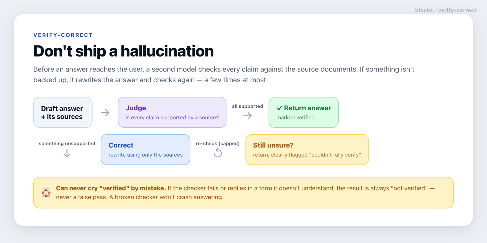

# verify-correct

**Catch a made-up answer before your users see it — check every claim against the sources, and fix it if it doesn't hold up.**



## What it does, in plain terms

AI models sometimes state things confidently that aren't in the source material — a "hallucination".
This block is the last gate before an answer ships.

Before the answer reaches the user, a second model acts as a **judge**: it reads the draft answer
alongside the source documents and asks *"is every claim here actually backed by a source?"*

- If **yes**, the answer is returned, marked *verified*.
- If **no**, the block **rewrites** the answer using only the sources, then checks again — looping a
  few times at most.
- If it still can't fully verify after those attempts, it returns the best answer **clearly flagged**
  ("couldn't fully verify"), so you can show it with a warning instead of presenting it as checked.

## Why it's safe

The failure direction is always "not verified" — **never a false "verified"**. If the judge or the
rewriter breaks, or replies in a form the block doesn't understand, the result is reported as
unverified rather than wrongly passed. A broken checker will never crash the answering flow, and the
number of attempts is capped so it can't loop forever. See [`SECURITY.md`](./SECURITY.md).

## Where it fits

The sources it checks against are the passages from [rag](../rag); the judge and rewriter models come
from [inference](../inference). It composes with both but depends on neither — plug in any models (or
deterministic fakes in tests).

<details>
<summary><b>For developers</b> — API and example</summary>

```ts
import { createVerifiedAnswer } from './lib/verify-correct/src';
import { aiJudge, aiCorrector } from './lib/verify-correct/adapters/ai-verify';

const answerer = createVerifiedAnswer<Query, Passage>({
  generate: async (q) => {                    // your RAG answer step
    const sources = await retrieve(q);
    return { answer: await draft(q, sources), sources };
  },
  judge: aiJudge({ model: 'anthropic/claude-haiku-5.5', renderSource: (p) => p.text }),
  correct: aiCorrector({ model: 'anthropic/claude-sonnet-5.5', renderSource: (p) => p.text }),
  maxAttempts: 2,                             // first pass + one correction
});

const { answer, verified, attempts, error } = await answerer.run(query);
// Show `answer`; if !verified, flag it ("couldn't fully verify") rather than presenting it as checked.
```

- `createVerifier({ judge, pass? })` → `verify(answer, sources)` → `{ verified, verdict, unsupported }`.
  Default pass = every claim supported; override `pass` (e.g. require ≥1 grounded claim).
- `createVerifiedAnswer({ generate, judge, correct, maxAttempts?, pass? })` → `run(input)` →
  `{ answer, verified, attempts, error? }`. `attempts` records each answer + its verdict + whether it
  was corrected, for auditing.
- `aiJudge` / `aiCorrector` (adapter) build a Judge/Corrector from AI SDK models; `renderSource` turns
  your source type into the text the model checks against. The judge parse is strict: an unparseable
  reply throws (→ unverified), and any `supported` value that isn't exactly `true` counts as
  unsupported.

Notes on the fail-safe behaviour: a throwing judge or corrector stops the loop and returns the current
answer with `verified: false` and an `error`; a throwing `generate` is re-thrown (it's the caller's own
error, not a verification failure).

### Scope

This block decides *whether* an answer is grounded and runs the correction loop; it doesn't write your
domain-specific prompts (the adapter's prompts are a sane default — tune them for your claims and
languages). Keep the judge model capable enough to catch real ungrounded statements, and gate shipping
a cheaper judge on an eval.

</details>
